# MEeL-HUB

<div align="center">

[🇬🇧 English](README-en.md)

</div>

<div align="center">
  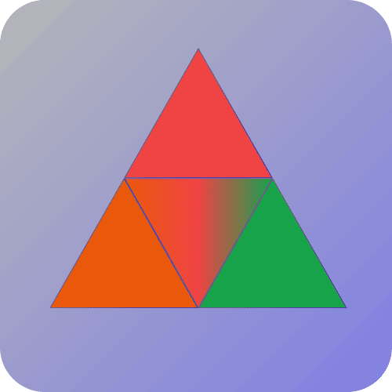
  <br><br>
  <strong>Platform media pribadi — self-hosted, open source, tanpa biaya langganan.</strong>
  <br>
  <sub>Video streaming, musik, e-book, dan file storage — semuanya dari server Anda sendiri. <a href="docs/id/arcade-optional.md">Arcade</a> tersedia sebagai ekstensi terpisah.</sub>
  <br><br>

[](https://www.php.net/)
[](https://www.mysql.com/)
[-007808?style=flat-square&logo=ffmpeg&logoColor=white)](tools/ffmpeg-lite)
[](LICENSE)
[](https://github.com/mifada2543/MEeL-HUB/actions/workflows/ci.yml)
[](https://github.com/mifada2543/MEeL-HUB)

</div>

<table>
  <tr>
    <td align="center"><strong>Beranda HUB</strong></td>
    <td align="center"><strong>Koleksi Video</strong></td>
    <td align="center"><strong>Music Discovery</strong></td>
  </tr>
  <tr>
    <td>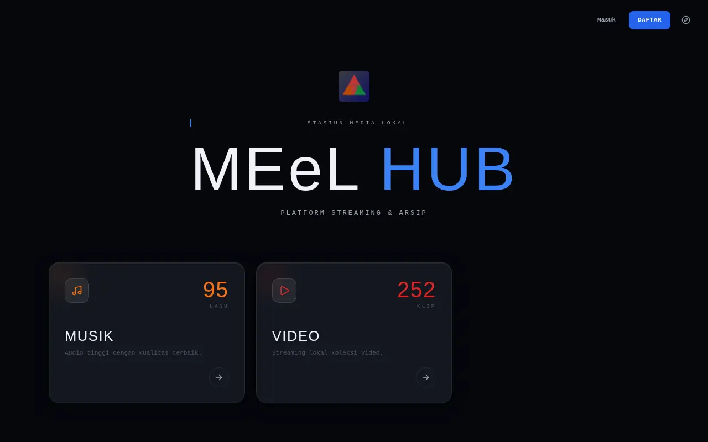</td>
    <td>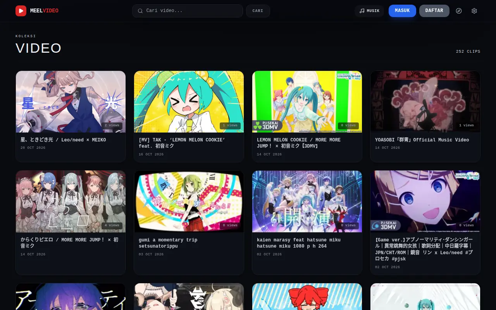</td>
    <td>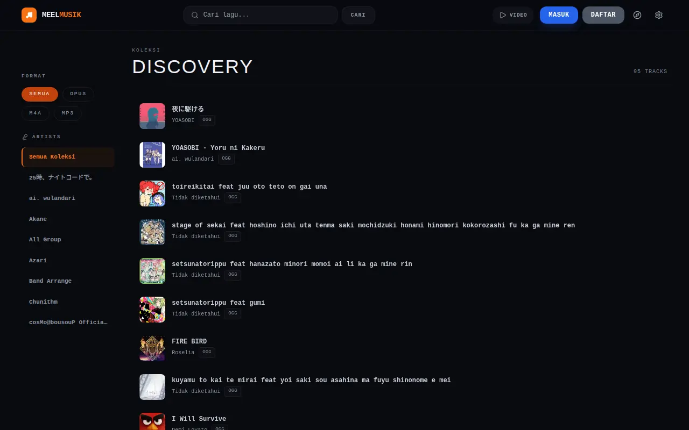</td>
  </tr>
</table>

---

## 📑 Daftar Isi

- [📸 Galeri Screenshot](#-galeri-screenshot)
- [✨ Fitur](#-fitur)
- [⚡ Quick Start](#-quick-start)
- [🛠 Tech Stack](#-tech-stack)
- [📁 Struktur Proyek](#-struktur-proyek)
- [📚 Dokumentasi](#-dokumentasi)
- [🧪 Testing](#-testing)
- [👥 Role-Based Access Control](#-role-based-access-control)
- [🤝 Contributing](#-contributing)
- [📄 License](#-license)

---

## 📸 Galeri Screenshot

Seluruh halaman di bawah ini bisa dibuka **tanpa login** (mode tamu). Semua gambar diambil langsung dari instance MEeL yang sedang berjalan, jadi tampilan di README selalu cocok dengan kode yang aktif.

<details>
<summary><strong>🖼️ Lihat 15 screenshot lainnya</strong></summary>

<h3 align="center">🎬 Video</h3>

<table>
  <tr>
    <td>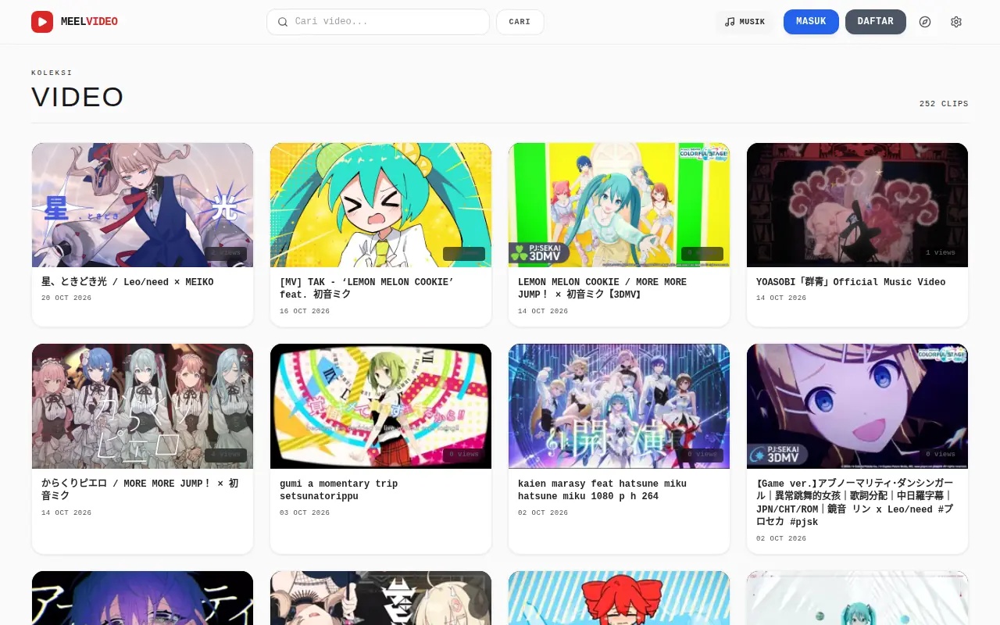</td>
    <td></td>
    <td></td>
  </tr>
  <tr>
    <td>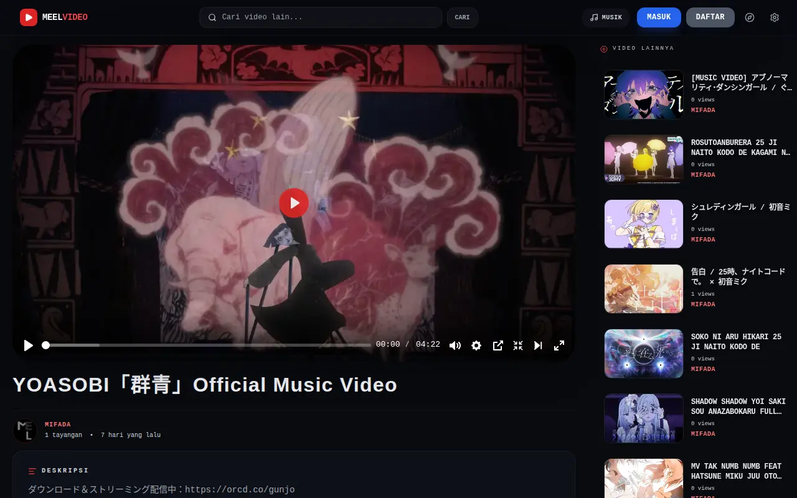</td>
    <td>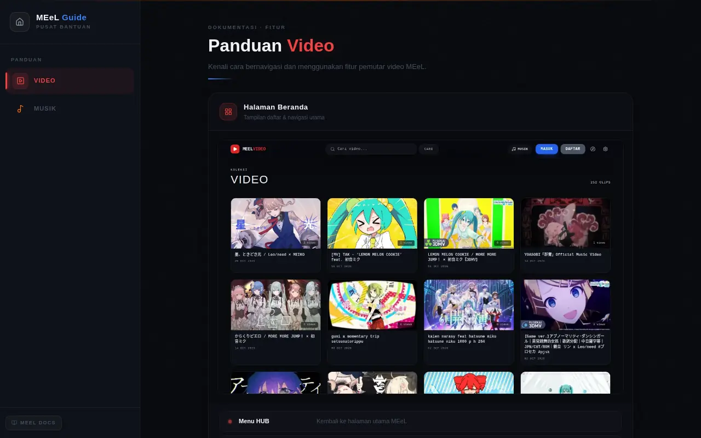</td>
    <td>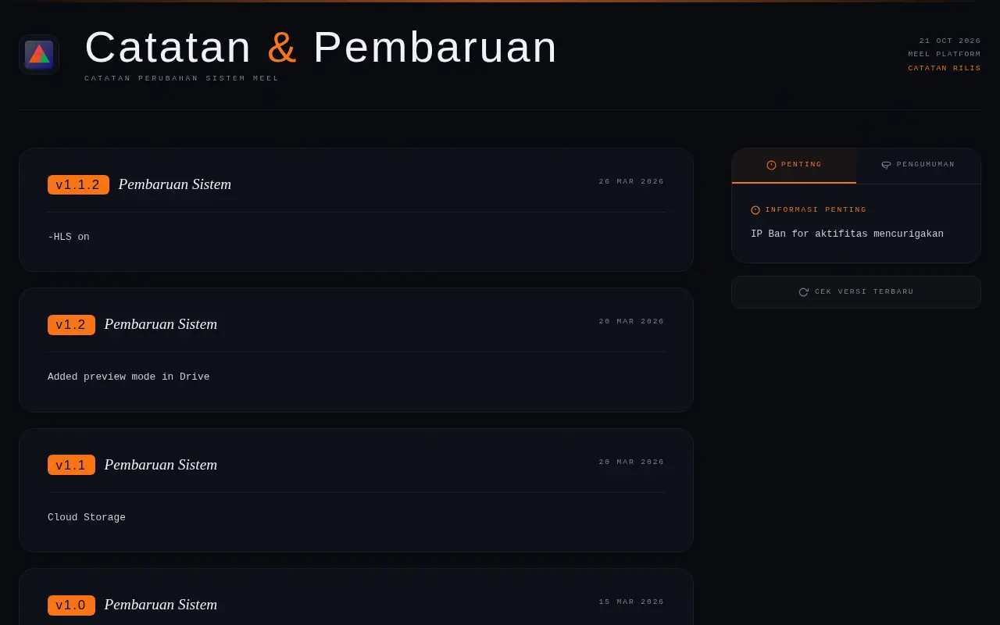</td>
  </tr>
</table>

<h3 align="center">🎵 Musik & Akun</h3>

<table>
  <tr>
    <td>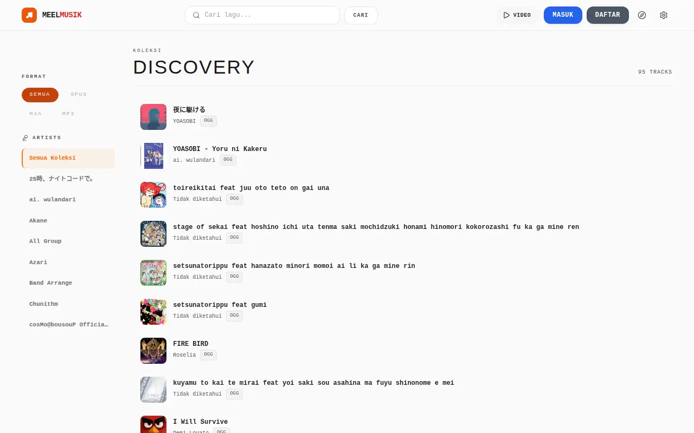</td>
    <td>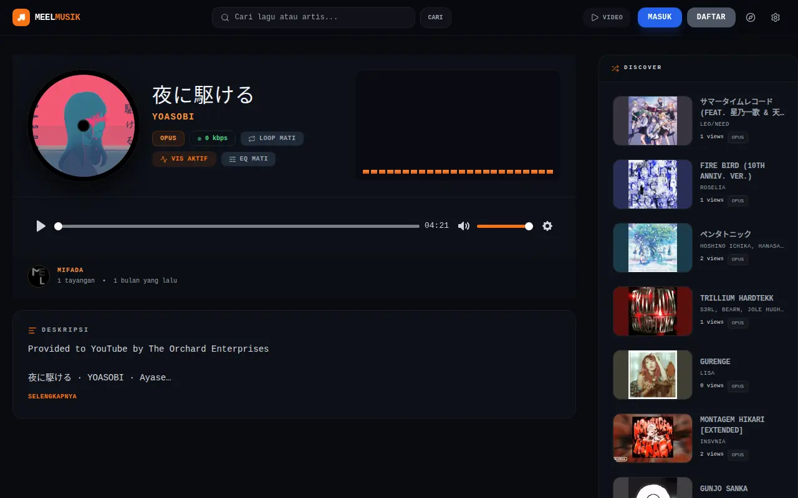</td>
    <td>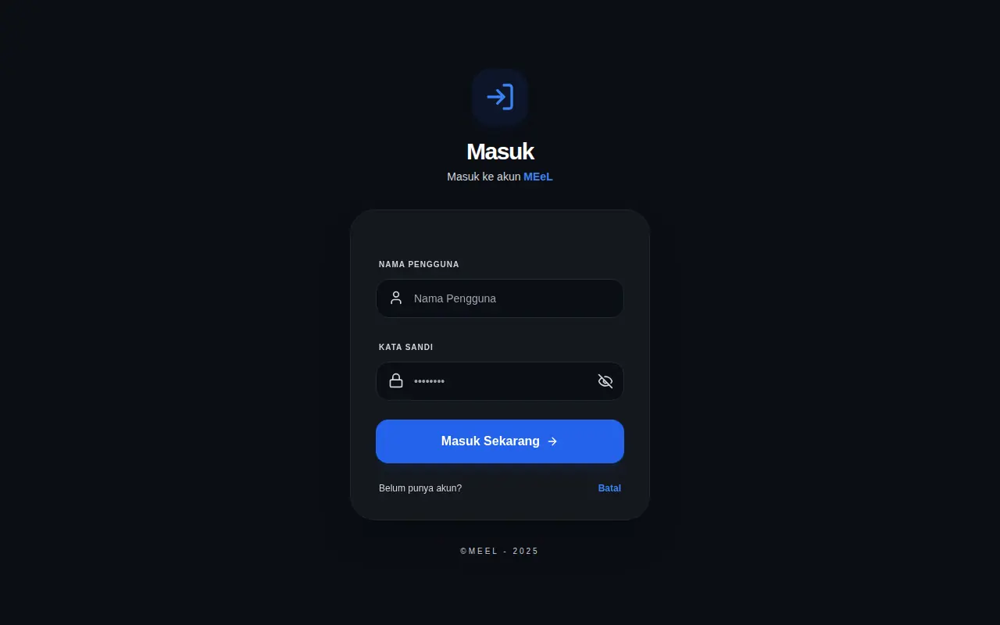</td>
  </tr>
  <tr>
    <td>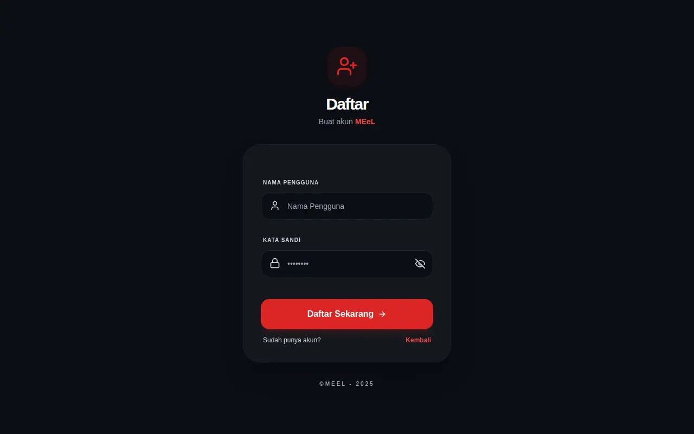</td>
    <td>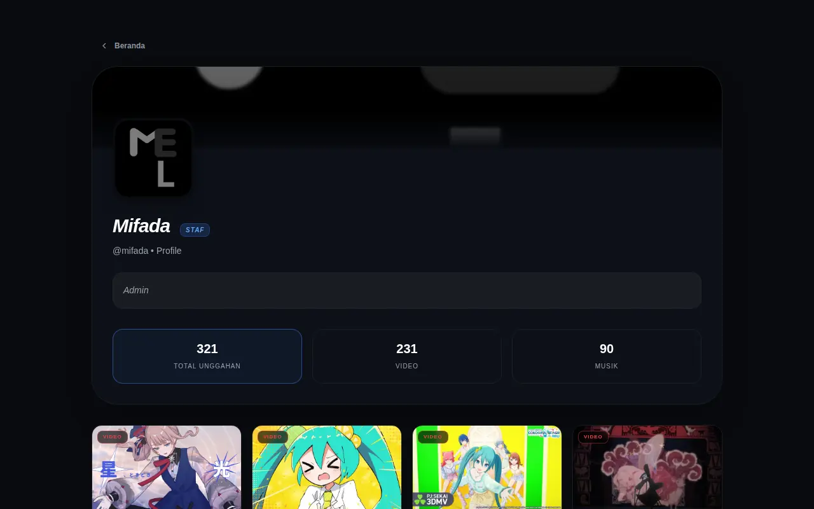</td>
    <td>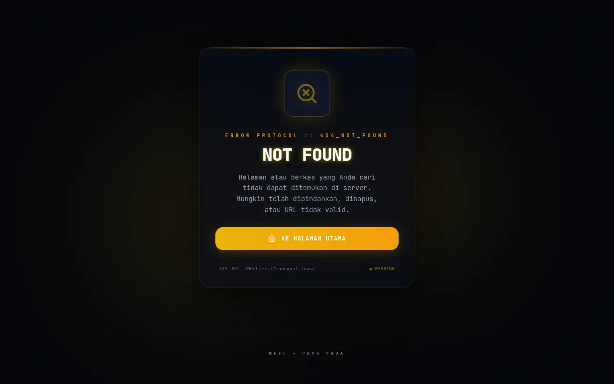</td>
  </tr>
</table>

<h3 align="center">🖥️ Sistem</h3>

<table>
  <tr>
    <td>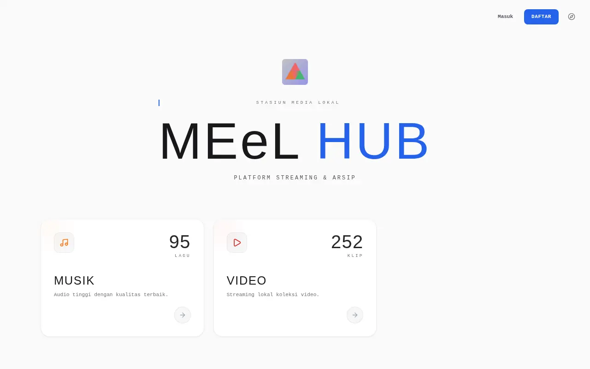</td>
    <td>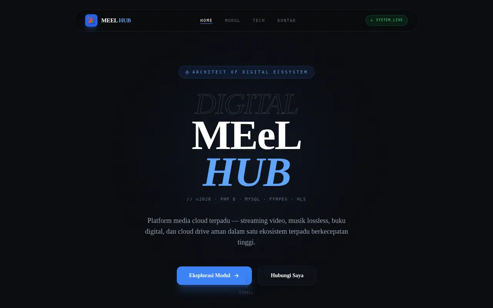</td>
    <td>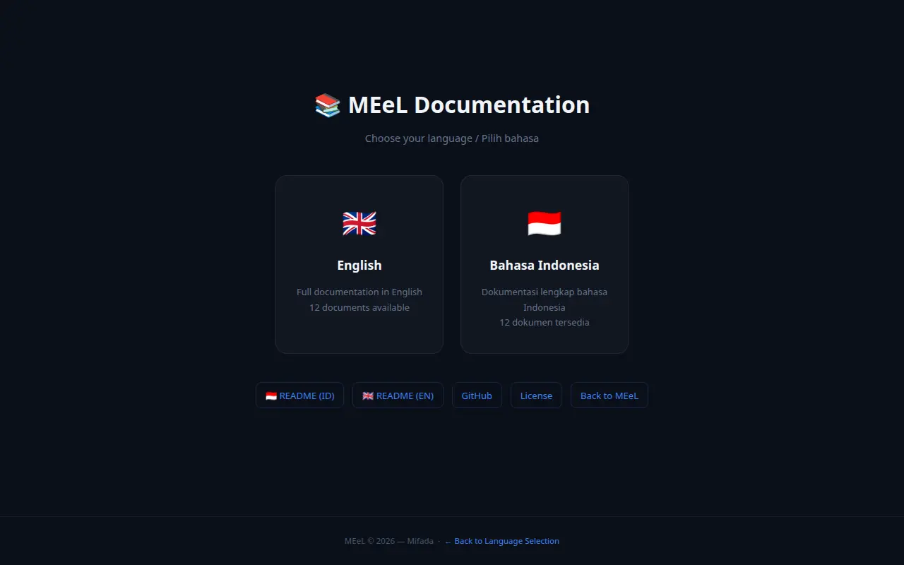</td>
  </tr>
</table>

</details>

---

## ✨ Fitur

<table>
  <tr>
    <td width="50%">
      <h3>🎬 Video</h3>
      <p>Pemain video berbasis HLS adaptive streaming. Mendukung subtitle, pemilihan resolusi, picture-in-picture, resume otomatis, pratinjau thumbnail, countdown auto-next, ambient glow, dan pemulihan koneksi.</p>
    </td>
    <td width="50%">
      <h3>🎵 Musik</h3>
      <p>Pemutar audio untuk MP3, FLAC, OGG, M4A dengan visualizer WebAudio. Lirik karaoke real-time dengan sinkronisasi timestamp (LRC). Pembuatan playlist, antrean cerdas, dan mini-player persisten di bagian bawah layar.</p>
    </td>
  </tr>
  <tr>
    <td width="50%">
      <h3>📚 Buku</h3>
      <p>Pembaca manga (ZIP/CBZ) dan PDF langsung di peramban. Thumbnail dihasilkan otomatis saat unggah, metadata terkelola dengan baik, antarmuka baca yang bersih.</p>
    </td>
    <td width="50%">
      <h3>☁️ Cloud Drive</h3>
      <p>Penyimpanan file dengan direktori publik dan privat. Kuota per anggota, penyaringan otomatis berdasarkan tipe, pratinjau di peramban, validasi magic bytes.</p>
    </td>
  </tr>
  <tr>
    <td colspan="2">
      <h3>🕹️ Arcade <sup>(ekstensi terpisah)</sup></h3>
      <p>
        9 mini-game: <strong>Miku &amp; Teto Run</strong> · <strong>Catur</strong> (multiplayer) · <strong>Snake</strong> · <strong>2048</strong> · <strong>Tetris</strong> · <strong>Breakout</strong> · <strong>Simon Says</strong> · <strong>Ludo</strong> · <strong>MEeL!Mania</strong> (rhythm)
        <br><sub>Ekstensi opsional — diinstal terpisah dari HUB. Lihat <a href="docs/id/arcade-optional.md">Panduan Arcade</a>.</sub>
      </p>
    </td>
  </tr>
</table>

**Fitur tambahan:** Dashboard admin · Transcoder · Pengunduh video dari URL (yt-dlp) · Komentar & obrolan · Like/dislike · Profil pengguna · Mode terang/gelap · PWA offline · MFA (TOTP) · Jejak audit · Sistem kuota MEeLCoin · Pembatasan laju

> 🔒 **Tanpa framework** — router, autoloader, dan proxy validasi anti-SSRF semuanya dikembangkan secara mandiri. Lihat [docs/id/security.md](docs/id/security.md) untuk informasi lebih lanjut.

---

## ⚡ Quick Start

```bash
git clone https://github.com/mifada2543/MEeL-HUB.git MEeL
cd MEeL
chmod +x install.sh
./install.sh
```

Satu perintah untuk menyiapkan semuanya — basis data, konfigurasi, folder penyimpanan, Apache, migrasi, dan verifikasi.

<details>
<summary><strong>Instalasi manual (7 langkah)</strong></summary>

```bash
# 1. Clone
git clone https://github.com/mifada2543/MEeL-HUB.git MEeL && cd MEeL

# 2. Database
mysql -u root -p -e "CREATE DATABASE MEeL DEFAULT CHARACTER SET utf8mb4 COLLATE utf8mb4_general_ci;"
mysql -u root -p MEeL < database/schema.sql

# 3. Konfigurasi
cp auth/settings.example.php auth/settings.php
cp auth/config.example.php auth/config.php
# Edit auth/settings.php — isi kredensial DB & set MEEL_HDD_BASE

# 4. Storage
mkdir -p data_drive/public data_drive/private_admins temp profile/upload \
         music/upload/file music/upload/thumbnail \
         books/upload/manga books/upload/pdf books/upload/thumbnail
sudo chown -R www-data:www-data data_drive temp profile/upload music/upload books/upload

# 5. Apache
sudo a2enmod rewrite headers && sudo systemctl restart apache2

# 6. Migrasi
php database/migrate.php

# 7. Verifikasi
php tools/check_deploy.php
```

</details>

> 📖 [Panduan instalasi lengkap](docs/id/installation.md) · [English](docs/en/installation.md)

---

## 🛠 Tech Stack

|              |                                               |
| ------------ | --------------------------------------------- |
| **Backend**  | PHP 8.2+ · MySQL/MariaDB · Apache             |
| **Frontend** | TailwindCSS · HTMX · Vanilla JS               |
| **Media**    | Plyr.js · HLS.js · FFmpeg · yt-dlp            |
| **Testing**  | PHPUnit 9.6 · GitHub Actions CI               |
| **Keamanan** | CSRF · Rate Limiting · MFA · Audit Log · RBAC |
| **Lainnya**  | PWA · Service Worker · Class-Map Autoloader   |

> Butuh: PHP 8.2+ dengan ekstensi `mysqli`, `pdo_mysql`, `gd`, `intl`, `zip`, `curl` · ffmpeg-lite 6.1.1 (bundled di `tools/ffmpeg-lite`) · Apache 2.4+ dengan `mod_rewrite`

---

## 📁 Struktur Proyek

```
MEeL/
├── admin/          # Panel admin
├── arcade/         # Ekstensi arcade (terpisah — lihat docs/id/arcade-optional.md)
├── assets/         # CSS, JS, gambar
├── auth/           # Autentikasi & config
├── books/          # Pembaca buku digital
├── controllers/    # API endpoints
├── database/       # Schema & migrasi
├── docs/           # Dokumentasi (id + en)
├── drive/          # Cloud drive
├── modules/        # Core logic (OOP)
├── music/          # Pemutar musik
├── scripts/        # Skrip utilitas (build CSS, audit, backup)
├── tests/          # PHPUnit tests (source repo; tidak ikut ZIP utama)
├── tools/          # Toolchain + health check (tools/check_deploy.php)
├── video/          # Pemutar video
└── install.sh      📄 # Installer satu komando
```

---

## 📚 Dokumentasi

|                       |              🇮🇩 ID               |              🇬🇧 EN               |
| --------------------- | :------------------------------: | :------------------------------: |
| Landing Page          |  [ID](docs/id/index.md)          |  [EN](docs/en/index.md)          |
| Instalasi             |  [ID](docs/id/installation.md)   |  [EN](docs/en/installation.md)   |
| Konfigurasi           |  [ID](docs/id/configuration.md)  |  [EN](docs/en/configuration.md)  |
| Modul & Arsitektur    |     [ID](docs/id/modules.md)     |     [EN](docs/en/modules.md)     |
| API                   |       [ID](docs/id/api.md)       |       [EN](docs/en/api.md)       |
| Keamanan              |    [ID](docs/id/security.md)     |    [EN](docs/en/security.md)     |
| Development           |   [ID](docs/id/development.md)   |   [EN](docs/en/development.md)   |
| Testing               |     [ID](docs/id/testing.md)     |     [EN](docs/en/testing.md)     |
| Troubleshooting       | [ID](docs/id/troubleshooting.md) | [EN](docs/en/troubleshooting.md) |
| PWA                   |       [ID](docs/id/pwa.md)       |       [EN](docs/en/pwa.md)       |
| Arcade                | [ID](docs/id/arcade-optional.md) | [EN](docs/en/arcade-optional.md) |
| Download              |     [ID](docs/id/download.md)     |     [EN](docs/en/download.md)     |

---

## 🧪 Testing

> Jalankan `php vendor/bin/phpunit --list-tests` untuk jumlah test terkini. CI menjalankan unit, integration, functional, dan security suites.
>
> Angka sengaja ditulis sebagai rentang kasar, bukan angka eksak: jumlah test naik terus seiring waktu, jadi angka eksak cepat basi. Kalau ingin mengukur sendiri:
>
> ```bash
> vendor/bin/phpunit --no-coverage --testsuite='MEeL Core Unit Tests'    | tail -3
> vendor/bin/phpunit --no-coverage --testsuite='MEeL Integration Tests'   | tail -3
> php tests/functional_test.php                                          # ringkasan di logs/
> php tests/security_test.php                                            # ringkasan di logs/
> ```

```bash
composer install
vendor/bin/phpunit --testsuite='MEeL Core Unit Tests'    # Unit
vendor/bin/phpunit --testsuite='MEeL Integration Tests'   # Integration (MySQL)
php tests/functional_test.php                              # Functional
php tests/security_test.php                                # Security
php tools/check_deploy.php                                 # Deployment
```

---

## 👥 Role-Based Access Control

| Role       | Akses                                                                          |
| ---------- | ------------------------------------------------------------------------------ |
| **Admin**  | Kendali penuh atas semua modul, panel admin, manajemen pengguna, transcode, log audit |
| **Member** | Semua media, komentar, buku, cloud drive (20 GB)                               |
| **User**   | Semua media, komentar, buku (tanpa drive)                                      |
| **Guest**  | Menonton/mendengarkan saja, pengaturan tema                                    |

---

## 🤝 Contributing

Kontribusi dalam bentuk laporan bug, saran fitur, atau pull request sangat diterima. Lihat [template laporan bug](.github/ISSUE_TEMPLATE/bug_report.md).

---

## 📄 License

[GNU Affero General Public License v3.0 (AGPLv3)](LICENSE) · © 2026 Mifada

---

## ⚠️ Disclaimer

> [!IMPORTANT]
> Mifada (pengembang) tidak bertanggung jawab atas konten media yang diunggah, disimpan, atau didistribusikan oleh pihak ketiga yang menggunakan atau memodifikasi MEeL-HUB. Segala risiko penggunaan dan kepatuhan hak cipta merupakan tanggung jawab masing-masing pengguna.

---

## 📚 Dokumentasi Lanjutan

- [Landing Page Dokumentasi (ID)](docs/id/index.md) · [Documentation Landing (EN)](docs/en/index.md)

---

## 📬 Kontak

**Email:** mifada2543@gmail.com · **GitHub:** [github.com/mifada2543](https://github.com/mifada2543)
